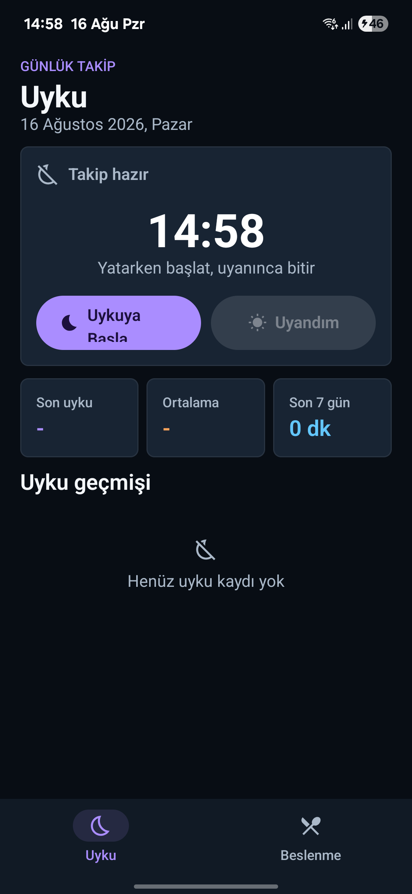
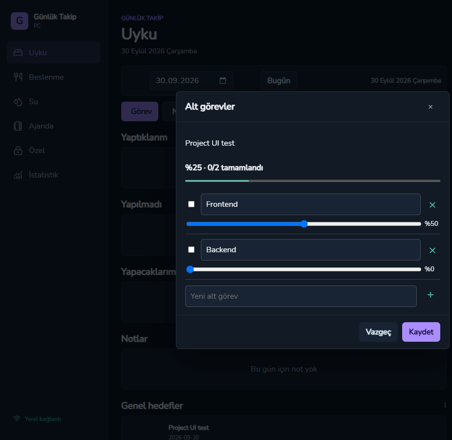

# Günlük Takip · Daily Tracker

**Offline-first personal tracker for Android with a Go/Wails desktop companion.**
Sleep, agenda tasks, daily habits, ideas and shopping lists — stored on your device, synced over your own network, no hosted backend.

[](https://kotlinlang.org)
[](https://developer.android.com/jetpack/compose)
[](https://developer.android.com/training/data-storage/room)
[](https://wails.io)
[](#requirements)
[](#privacy-and-sync)



## Features

- **Sleep tracking** — one tap to start, one tap to wake up; live timer, history and averages.
- **Agenda** — dated tasks, notes, general goals, subtasks with progress, per-task timers, daily counters and streaks, calendar and a notebook view.
- **Task priority** — swipe a task row left/right to lower or raise its priority; high-priority tasks float to the top.
- **Daily repetition** — `Yaptım` increments the selected day, `−` undoes it; every day starts at zero.
- **Shopping list** — short/long-term lists, purchase check-off, and day-by-day grouping (`Bugün`, `Dün`, date).
- **Ideas** — undated notes kept separate from the agenda.
- **Stats** — period summaries and goal progress.
- **Local encrypted sync** — Android ↔ desktop over LAN with a pairing code; record-level last-write-wins.
- **MCP bridge** — optional stdio MCP server so local AI clients can read/write records through an explicit, revocable app key.
- **No accounts, no ads, no telemetry, no hosted backend.**

## Screenshots

| Sleep | Agenda | Desktop sync |
| --- | --- | --- |
|  |  | QR pairing from the desktop companion (not pictured for privacy) |

## Architecture

```text
:app
  ├── :feature:sleep ─────┐
  ├── :feature:agenda ────┤
  ├── :feature:stats ─────┼──► :data ──► Room (SQLite)
  ├── :feature:ideas ─────┤       │
  ├── :feature:shopping ──┘       └──► :core (models, theme, shared UI)
  └── :feature:settings

desktop-wails/  Go + Wails v2 companion, encrypted LAN sync peer
mcp-bridge/     Go stdio MCP server (optional)
sync-protocol/  Shared Java sync packet + crypto
```

- Feature modules never depend on each other; UI only sees repository APIs and core models.
- Room is the single source of truth; schemas are versioned under `data/schemas/` and every change ships a migration.
- Sync uses record-level last-write-wins with tombstones; device-local state (running timers, task priorities) is preserved locally.

## Requirements

- Android 8.0 (API 26) or newer
- Android Studio with the Gradle JDK (see `gradle.properties`)
- For the desktop companion: Go, Node.js, Wails v2 and WebView2 (Windows)

## Build

### Android

```powershell
.\gradlew.bat test
.\gradlew.bat :app:assembleOptimized
```

The signed-by-debug-key optimized APK lands in `app/build/outputs/apk/optimized/app-optimized.apk`.
`local.properties` (SDK path) is intentionally not committed.

### Desktop companion

```powershell
cd desktop-wails
go test ./...
cd frontend
npm ci
npm test
npm run build
cd ..
wails build -skipbindings -s
```

### MCP bridge (optional)

See [mcp-bridge/README.md](mcp-bridge/README.md). The bridge is off by default, requires an explicit access key, and never exposes health or pairing secrets.

## Privacy and sync

- Real device backups, databases, pairing files, raw screenshots, local settings and build outputs are **excluded from Git**. Published screenshots are reviewed and stripped of metadata.
- Nothing leaves your devices unless you start a LAN sync or explicitly grant MCP access on the phone.
- Daily counters stay local; only the aggregate completed-day count is synced.

## Project docs

- [ARCHITECTURE.md](ARCHITECTURE.md) — module rules, data strategy, UI state flow
- [PRODUCT_PROMPT.md](PRODUCT_PROMPT.md) — original product brief
- [docs/PC_MOBILE_SYNC_PLAN.md](docs/PC_MOBILE_SYNC_PLAN.md) — sync protocol plan
- [docs/MCP_RESEARCH_AND_PLAN.md](docs/MCP_RESEARCH_AND_PLAN.md) — MCP bridge design notes

## Status

Personal project under active development. Interfaces, sync protocol and database schemas may change between versions; migrations are provided for data that already exists on devices.
